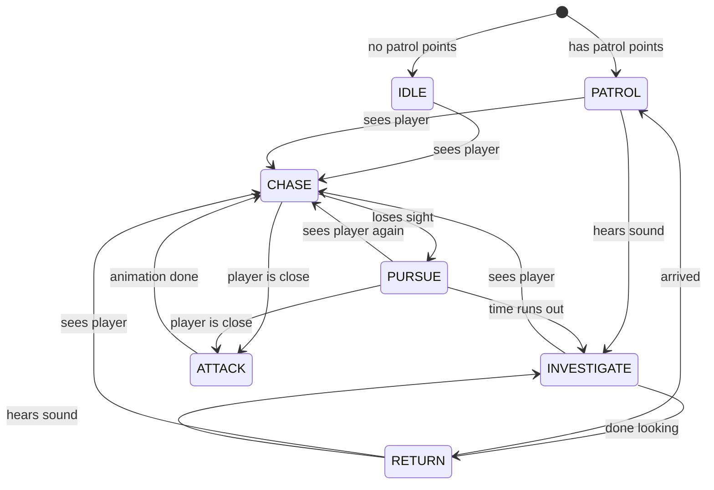

# Guard AI

This is the enemy guard for the game.
The guard walks around, looks for the player, listens for sounds, and chases the player when it sees her.

The guard is controlled by a **state machine**. This means the guard is always in exactly one *state* (like "patrol" or "chase"). Each state has its own behaviour, and the guard switches to another state when something happens.

---

## How the guard works

Every physics frame, the guard does these things in order:

1. **Update the path** – About 5 times per second (`update_interval`), the guard tells its `NavigationAgent3D` where it wants to go. The agent finds a path around walls.
2. **Run the current state** – The guard runs the code for the state it is in right now. Most states check if the guard can see the player (see *Vision* below).
3. **Gravity** – If the guard is not on the floor, it falls.
4. **Move** – `move_and_slide()` moves the guard.

### Vision

The guard carries a **flashlight** (a `SpotLight3D` called **Flashlight**). The guard can only see what is inside the light.

To see the player, two things must be true:

1. **The player is inside the light cone.**
   - The player is not further away than the flashlight's `spot_range`.
   - The angle between the flashlight's direction and the player is not bigger than the flashlight's `spot_angle`.
2. **Nothing is in the way.**
   - The guard points a `RayCast3D` called **VisionRay** straight at the player and checks it right away (`force_raycast_update()`).
   - If the ray hits the player first, the guard **can see** the player.
   - If the ray hits a wall or a box first, the guard **cannot see** the player.

The ray aims at a point `aim_height` metres above the player's origin, so it does not hit the floor under the player.

The guard reads the range and the angle directly from the flashlight. This means **what you see in the game is what the guard sees**: if you change `Range` or `Angle` on the Flashlight, the guard's vision changes too.

The player can hide in two ways:

- **Stay out of the light.** Outside the cone the guard cannot see you, even if you are very close.
- **Hide behind something.** Walls and objects block the ray, and they also block the light (the flashlight has shadows turned on).

The level should be dark, so the player can clearly see where the flashlight is pointing.

### Hearing

Other scripts can make the guard hear a sound:

```gdscript
guard.hear_noise(some_position)
```

The guard will walk to that position and look around.
The guard ignores sounds when it is busy chasing or attacking the player.

### Walking and running

The guard walks with the **Walk** animation and runs with the **Run** animation.
It turns smoothly towards the direction it is moving.

---

## The states

| State | What the guard does | When it changes |
|---|---|---|
| **IDLE** | Stands still. Used when the guard has no patrol points. | Sees the player → **CHASE** |
| **PATROL** | Walks from patrol point to patrol point. Waits a few seconds at each point. | Sees the player → **CHASE**<br>Hears a sound → **INVESTIGATE** |
| **INVESTIGATE** | Walks to a position (a sound, or where the player was last). When it arrives, it turns left and right to look around. | Sees the player → **CHASE**<br>Done looking → **RETURN** |
| **CHASE** | Runs after the player. | Player is close → **ATTACK**<br>Loses sight of the player → **PURSUE** |
| **PURSUE** | Keeps running after the player for a short time, even without seeing them. This makes it harder to escape by just running around a corner. | Sees the player again → **CHASE**<br>Player is close → **ATTACK**<br>Time runs out → **INVESTIGATE** |
| **ATTACK** | Stops and plays the **Attack** animation. | Animation is finished → **CHASE** |
| **RETURN** | Walks back to the place where it stopped its patrol. | Arrives → **PATROL**<br>Sees the player → **CHASE**<br>Hears a sound → **INVESTIGATE** |

### State diagram



### The return position

When the guard leaves its normal routine (IDLE, PATROL or RETURN) to chase or investigate, it saves its position in `return_position`.
Later, the **RETURN** state walks back to this position. This way the guard goes back to where it was, not to a random place in the middle of a chase.

### Looking around

When the guard arrives at the investigate position, it waits for `investigate_wait_time` seconds.
During this time it turns left, back to the middle, right, and back to the middle again.
This uses a `sin()` curve, so the movement is smooth.
The flashlight is a child of the guard, so it turns with it. The light sweeps across the room, and the guard can find a player who is hiding next to it.

---

## Settings

You can change these in the **Inspector** when the Guard node is selected.

| Setting | Default | What it does |
|---|---|---|
| `patrol_points` | empty | The points the guard walks between, in order. |
| `speed_walk` | 1.7 | Speed when walking (patrol, investigate, return). |
| `speed_run` | 3.0 | Speed when running (chase, pursue). |
| `attack_range` | 2.0 | How close the player must be before the guard attacks. |
| `investigate_wait_time` | 4.0 | How many seconds the guard looks around when investigating. |
| `patrol_wait_time` | 3.0 | How many seconds the guard waits at each patrol point. |
| `update_interval` | 0.2 | How often (in seconds) the guard updates its path. |
| `pursue_time` | 2.5 | How many seconds the guard keeps chasing after it loses sight of the player. |
| `look_around_angle` | 70.0 | How far (in degrees) the guard turns to each side when looking around. |
| `aim_height` | 0.8 | How high above the player's origin the vision ray aims. |

The guard's vision is set on the **Flashlight** node:

| Setting | Example | What it does |
|---|---|---|
| `Spot > Range` | 6.5 | How far the guard can see. |
| `Spot > Angle` | 30° | How wide the guard can see. This is the angle from the middle of the cone to the edge, so 30° gives a 60° wide cone. |

---

## Setup

### Scene structure

```
Guard (CharacterBody3D)   ← the guard script goes here
 ├─ CollisionShape3D      ← a capsule
 ├─ NavigationAgent3D
 ├─ VisionRay (RayCast3D) ← at eye height (its length is set by the script)
 ├─ Flashlight (SpotLight3D) ← at hand/chest height, pointing forward (-Z), shadows on
 ├─ Model                 ← the 3D character (rotated 180° on Y)
 └─ AnimationPlayer       ← Root Node set to "Model"
```

In `_ready()`, the script makes the VisionRay as long as the flashlight's range, so you do not need to set its length yourself.

### Animations

The `AnimationPlayer` needs four animations with these exact names:

| Name | Loop |
|---|---|
| `Idle` | Yes (Linear) |
| `Walk` | Yes (Linear) |
| `Run` | Yes (Linear) |
| `Attack` | No |

The animations in this project come from **Mixamo**. Walk and Run were downloaded with **In Place** turned on, because the script moves the guard, not the animation.

**Why is the Model rotated 180°?** Mixamo characters face +Z, but Godot's `look_at()` expects the front to be -Z. Turning the Model (not the Guard) fixes this.

**Why is Root Node set to Model?** The animation tracks use paths like `Skeleton3D:mixamorig_Hips`. The skeleton is inside Model, so the AnimationPlayer must start looking from there.

### In the level

1. The level needs a **NavigationRegion3D** with a baked navigation mesh.
2. Add some **Marker3D** nodes on the floor as patrol points. Do not put them inside the Guard node, because then they move with the guard.
3. Select the Guard and add the markers to **Patrol Points** in the Inspector.
4. The player must be available as `PlayerManager.player` (for example with an autoload).
5. Make the level dark (low ambient light, weak or no directional light), so the flashlight is easy to see.

---
